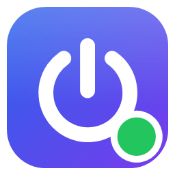

# DevSwitch



App de escritorio para Windows (WPF, .NET 11) que enciende y apaga lo que más RAM consume en un equipo de desarrollo, y muestra cuánta memoria usa cada cosa.

| Tarjeta | Cómo la controla |
| --- | --- |
| SQL Server 2025, MySQL | Servicios de Windows (necesita abrir la app como administrador). Incluye la casilla "Iniciar con Windows". |
| Docker Desktop | Abre la app / `docker desktop stop` |
| PostgreSQL, MongoDB, SQL Server (Docker), Redis, Oracle | Perfiles de `C:\dev\databases\compose.yaml` |
| WSL 2 | `wsl --shutdown` (solo apagar) |
| Emulador de Android | Primer AVD del SDK / `adb emu kill` |

El estado se actualiza cada 5 segundos.

## Compilar y ejecutar

```powershell
dotnet run
```

Para instalarla en el menú Inicio:

```powershell
dotnet publish -c Release -o "$env:LOCALAPPDATA\Programs\DevSwitch"
```

## Agregar otra tarjeta

Añade una línea en [`Catalog.cs`](Catalog.cs): `ServiceGroup` para servicios de Windows, `ComposeSwitch` para un servicio de Docker Compose.

## Icono

`Assets/make-icon.ps1` genera `DevSwitch.ico` (todas las resoluciones) y `DevSwitch-256.png`.

Los errores no controlados se guardan en `%LOCALAPPDATA%\DevSwitch\error.log`.
